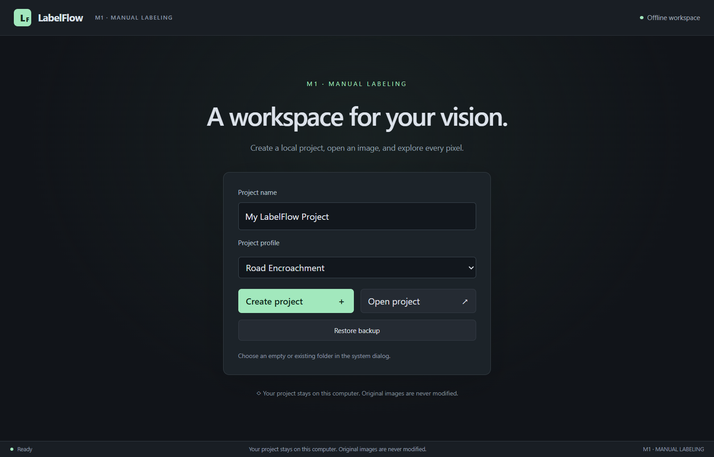
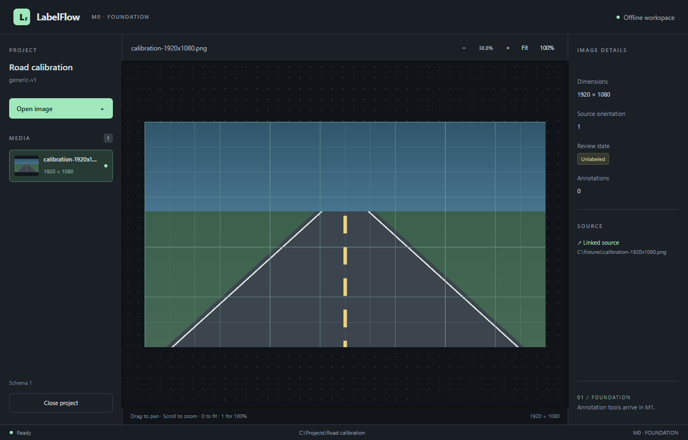
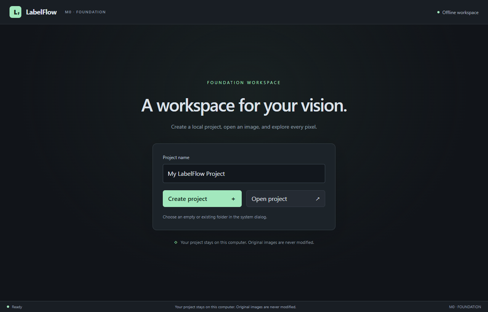

# M0 — Foundation and technical spike

Ngày bàn giao: 2026-11-06. Đã đọc toàn bộ master plan, triển khai M0 và dừng trước M1. Không có cloud, API server, tài khoản, telemetry, video, AI hay model weights.

## Checklist nghiệm thu

- [x] Tauri 2 + React + TypeScript strict + Rust, Vite và Tailwind; unit/lint/format/Clippy/build scripts.
- [x] Desktop shell dark theme: Project Home, media panel, Canvas2D, inspector, status/error bar; chuỗi UI tập trung trong catalog.
- [x] Tạo/mở/đóng project, manifest versioned, SQLite migration transaction, FK, WAL, integrity check, typed error và IPC allowlist.
- [x] Lock single-writer: từ chối writer thứ hai cùng tiến trình và khác tiến trình; giải phóng sau khi exit không chạy destructor. Không xóa lock file.
- [x] Đọc ảnh liên kết không sửa nguồn; PNG/JPEG/WebP, EXIF orientation canonical, SHA-256 và khôi phục ảnh gần nhất khi mở project.
- [x] Fixture 1920×1080, zoom-to-pointer, pan, Fit/100%, DPR; round-trip và drift tests.
- [x] Frontend production build và Windows executable release build từ dependency cài sạch; executable release đã khởi chạy với WebView2.
- [x] Desktop smoke bản debug có frontend nhúng: cửa sổ thật, assets thật, IPC Rust thật và typed `noProject` error. Không dùng Vite/browser mock trong test này.
- [x] Hướng dẫn Ubuntu 24.04 và CI matrix Windows/Ubuntu được thêm.
- [ ] Chạy build/app thực tế trên Ubuntu; máy hiện tại chỉ là Windows x64. CI mới được cấu hình, chưa có kết quả remote CI.
- [ ] Kiểm tra thủ công native folder/file picker. Helper Computer Use lỗi khởi tạo sandbox sau reset/thử lại; browser test giả lập IPC không xác minh native picker.

Hai mục cuối là giới hạn xác minh cần ghi nhận khi review, không phải chức năng M1 đã triển khai dở.

## Kết quả kiểm thử

| Lệnh                                            | Kết quả                                                                                                  |
| ----------------------------------------------- | -------------------------------------------------------------------------------------------------------- |
| `npm.cmd test`                                  | 42/42 test TypeScript qua                                                                                |
| `npm.cmd run rust:test`                         | 16/16 test Rust qua; 1 helper ignored ở runner chính, được test cha gọi trong tiến trình con             |
| `npm.cmd run test:ui`                           | 4/4 Playwright test qua, gồm DPR 2; IPC mock chỉ nằm trong test                                          |
| `npm.cmd run test:desktop`                      | Qua: debug executable thật, embedded frontend, IPC thật, screenshot; CDP chỉ bật bằng config smoke riêng |
| `npm.cmd run typecheck`, `lint`, `format:check` | Qua                                                                                                      |
| `npm.cmd run rust:fmt`, `rust:check`            | Qua, Clippy `-D warnings`                                                                                |
| `npm.cmd run build`, `desktop:build`            | Qua; `src-tauri/target/release/labelflow.exe`                                                            |
| `npm.cmd audit`, `npm.cmd ls`                   | 0 advisory npm, cây dependency hợp lệ                                                                    |

Các tình huống đã kiểm tra: round-trip tại nhiều mức zoom, tọa độ lẻ/border, 1.000 chu kỳ zoom thuận/nghịch không drift đáng kể, CSS scaling/DPR, native-dialog cancellation qua IPC mock, lỗi IPC, Unicode path/name, project manifest/DB không khớp, DB thiếu/hỏng/phiên bản tương lai, migration idempotent/backup committed WAL/rollback, CHECK/FK constraints, lock giữa các tiến trình, process exit đột ngột, ảnh hỏng/mất/thay đổi/quá lớn, relative path traversal và EXIF JPEG orientation 6.

Lỗi đã sửa qua kiểm tra: API backup thay đổi trong rusqlite, mã lock contention đặc thù Windows, lifecycle refs/effects theo React lint, trường hợp ảnh cache load trước ResizeObserver, cập nhật DPR khi chuyển monitor và dependency advisory. Browser smoke từng timeout ở initial page load trong lúc compile release; chạy riêng sau build qua đủ 4/4 test. Biến môi trường CDP không được WebView2 trên máy này áp dụng, nên desktop smoke dùng config debug riêng; config production không chứa cổng debug.

Không đo startup/memory/p50/p95/FPS nên không khẳng định đạt các performance target trong master plan. RustSec audit chưa chạy. Ubuntu system-library/distribution-license review còn cần trước khi phát hành installer. Xem [dependency inventory](../architecture/third-party.md).

## Demo và screenshots

Theo [README](../../README.md): chạy `npm.cmd run desktop:dev` hoặc executable release, tạo project trong thư mục chưa có `.labelflow`, mở `tests/fixtures/calibration-1920x1080.png`, zoom/pan/Fit/100%, đóng rồi mở lại project.

## Các nhóm file được thêm

- Tooling: `package.json`, npm lockfile, TypeScript/Vite/ESLint/Prettier/Playwright config, `.gitignore`, `.github/workflows/ci.yml`, `scripts/rust.mjs`.
- Frontend: `src/app/*`, `src/main.tsx`, `src/lib/contracts/index.ts`, `src/lib/backend.ts`, frontend project/media services, `features/annotations/geometry/*`, `canvas/ImageCanvas.tsx`.
- Backend: Cargo manifest/lockfile, build/entrypoint, `domain`, `commands`, `services`, `repositories`, `database`, `security`, migration `0001_foundation.sql`, capabilities và command permissions tự sinh, original icons.
- Kiểm thử/fixtures: frontend tests, `src-tauri/tests/foundation.rs`, `tests/ui/workspace.spec.ts`, original PNG/corrupt fixture, fixture generator và desktop smoke script/config.
- Tài liệu: README, ADR 0001, project-v1/migration notes, dependency inventory/script, báo cáo này và 3 screenshots. Master plan giữ nguyên.

## Quyết định, compatibility và giới hạn

Chi tiết ở [ADR 0001](../decisions/0001-architecture.md) và [format/migration](../formats/project-v1.md). Schema 1 chỉ tạo `projects`, `media`, `workspace`; các bảng annotation/mask/class/layer chưa được dùng nên triển khai cùng M1. Profile M0 là `generic-v1`. Không diễn giải lại Road Extent thành semantic road.

M0 hiển thị một ảnh active; lịch sử media có trong DB nhưng chưa có batch browser/import/copy/remap. Mỗi lần launch cần tự mở project; recent-project/session/panel-width restore chưa có. Preview base64 PNG có giới hạn 64 MiB nguồn, 24 megapixel và allocation limit decoder 128 MiB; chưa có thumbnail cache hay bộ đệm ảnh có budget. Không có annotation nên chưa có autosave/journal/undo. M0 dùng phím `1` cho 100%; M1 cần trả `1..9` cho class hotkeys. Chưa tạo/chứng thực installer NSIS/MSI/AppImage/deb; release executable là artifact chạy local.

Project lỗi do ngắt lúc tạo được giữ nguyên và từ chối ghi đè; chọn thư mục mới, không tự xóa metadata. Linked sources có thể mất; M0 báo lỗi, không tự cập nhật nội dung nguồn đã thay đổi. Backup DB trước migration có test; backup/restore DB cùng mask assets phải bổ sung khi M1 tạo masks.

## Checklist M1 đề xuất — chưa triển khai

1. Import ảnh/thư mục, thumbnail queue, navigation/filter, copied/linked mode và session state; thay base64 preview bằng tài nguyên ảnh scoped có budget.
2. Class/layer models và Road Encroachment profile với Cityscapes train IDs 0..18, ignore 255; semantic masks, Road Extent, traffic exclusion, suspected region và image event độc lập.
3. Bbox/polygon/select/brush/eraser; command-pattern undo/redo, shortcut/class palette và overlay opacity.
4. Migrations annotation/mask/revision/operation-log; autosave theo thứ tự, stale-revision rejection, durable journal, crash recovery và backup DB + masks.
5. YOLO detection + semantic PNG export, mapping/import/round-trip; gate kích thước, bounds, class ID và ignore semantics.
6. Nghiệm thu 100 ảnh thật offline, đóng/mở không mất labels/masks, sai số YOLO <1 pixel ở 1080p, ≥100 geometry/serialization assertions có ý nghĩa, kiểm tra brush/navigation và đo baseline trên phần cứng được ghi nhận.

Chờ người dùng kiểm tra M0 trước khi thực hiện checklist này.

## Bản vá launcher Windows — 2026-11-07

Khắc phục lỗi Tauri `beforeDevCommand` báo `'npm' is not recognized`. Launcher cũ chỉ đọc thuộc tính `PATH` sau khi sao chép environment sang object JavaScript; Windows có thể dùng tên `Path`, khiến đường dẫn kế thừa bị mất hoặc trùng key khi thêm Rust. `scripts/environment.mjs` giữ đường dẫn kế thừa, chuẩn hóa một key PATH trên Windows và thêm thư mục của Node đang chạy; chỉ cập nhật environment của tiến trình con. Không sửa PATH hệ thống và không cần cài lại dependency.

Thêm 6 test launcher, gồm tiến trình cmd thật tìm npm với environment dùng `Path`, vào `npm run test:tooling` và `npm run check`. Lint, typecheck, formatting và 42 test frontend tiếp tục qua. Phạm vi vẫn là sửa M0, chưa triển khai M1.
