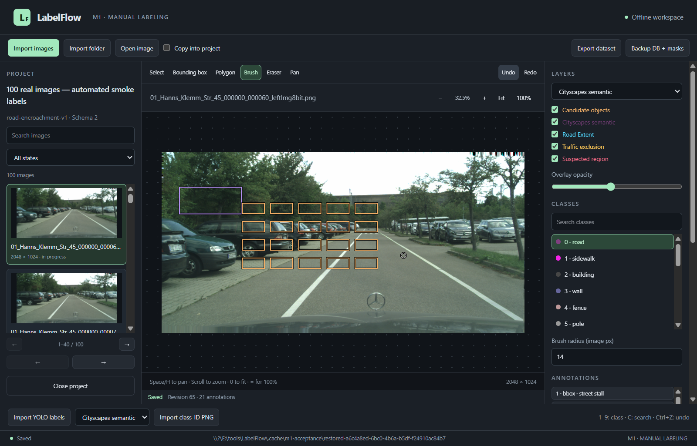
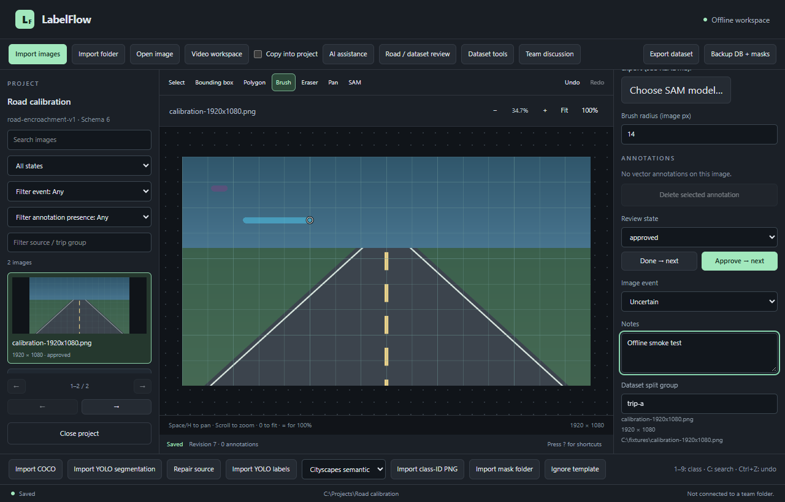
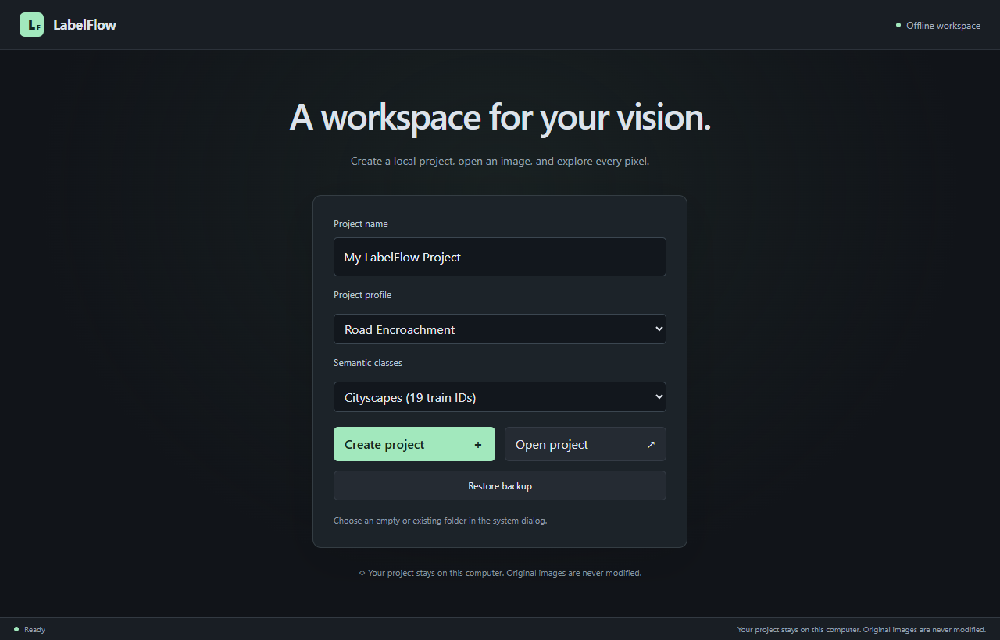

# M1 — Usable manual labeling MVP

Ngày kiểm tra: 2026-11-07, Windows x64. Phạm vi dừng tại M1 theo yêu cầu; chưa triển khai M2, cloud, server hoặc AI. Xem [cách chạy/demo](../../README.md), [ADR M1](../decisions/0002-manual-labeling.md) và [migration/format](../formats/project-v2.md).

## Chức năng bàn giao

- Import ảnh/thư mục hoặc drag/drop, linked/managed mode, chống trùng, thumbnail cache, phân trang 40 ảnh, tìm kiếm/lọc review và điều hướng qua các trang. Có tiến độ, hủy job, báo cáo ảnh lỗi.
- Bbox, polygon đơn, select/move/resize bbox, di chuyển polygon/đỉnh, brush/eraser, zoom/pan/Fit/100%, class search/numeric hotkeys, layer visibility/opacity. Vẽ mask theo dirty rectangle, không tạo React node cho từng pixel.
- Road profile: Cityscapes train IDs 0–18 + ignore 255; Road Extent, traffic exclusion và suspected region độc lập; candidate objects 5 class. Event positive/negative/uncertain, notes, review state, split group.
- Undo/redo từng phiên ảnh; mỗi stroke hoàn tất là một command. Queue lưu có thứ tự, revision/conflict rejection, UUID idempotency, durable IndexedDB outbox, SQLite operation log và mask PNG immutable. Chặn navigation/close khi còn draft hoặc lưu thất bại. Lần launch sau khôi phục project/ảnh và panel widths; last-used class/layer được giữ lại.
- YOLO detection và semantic/region PNG export, canonical ảnh đã chuẩn hóa EXIF, class map, group/seed split và checksum manifest; output được verify trước rename, không ghi đè export cũ. Import detection và PNG với mapping tường minh, không ghi đè ảnh approved.
- Backup/restore DB + masks, checksum assets, kiểm tra orphan/missing/corrupt masks, nhật ký recovery, job status bền vững và hướng dẫn chạy lại job bị ngắt. Giữ nguyên file nguồn.

## Checklist nghiệm thu và bằng chứng

| Tiêu chí M1                                    | Kiểm tra                                                                                                                                                                              |
| ---------------------------------------------- | ------------------------------------------------------------------------------------------------------------------------------------------------------------------------------------- |
| 100 ảnh thật offline, lưu nhãn không mất       | Rust integration nhập 100 ảnh khác nhau từ LostAndFound train, tạo bbox + semantic + 3 region masks + event/review/notes cho từng ảnh, reopen và so sánh toàn bộ document             |
| Đóng/mở, exact annotations và referenced masks | Test reopen/backup/restore so sánh bằng `assert_eq`; subprocess thoát ngay không chạy destructor xác minh committed WAL + PNG assets; journal pending được recover qua browser reload |
| PNG đúng kích thước và IDs                     | Decode từng semantic PNG của cả 100 ảnh, kiểm tra W×H và IDs 0/13/18/255; test riêng indexed PNG giữ nguyên indices                                                                   |
| YOLO sai số <1 pixel tại 1080p                 | Fixture 1920×1080 round-trip từng tọa độ với tolerance `1e-6` pixel; 120 case pure geometry round-trip và kiểm tra bbox/polygon/hole/border                                           |
| ≥100 assertions có ý nghĩa, test xanh          | 195 test TS, 28 test Rust thông thường, 6 test launcher, 11 browser workflow tests; thêm bài dataset thật riêng                                                                       |
| Brush/navigation hoạt động với scene đại diện  | Kiểm tra browser brush/eraser, select/move/resize, pan, review, failed-save guard; kiểm tra packaged Tauri thật bằng script desktop riêng                                             |

**Dữ liệu thật và ý nghĩa nghiệm thu:** người dùng đã cho phép dùng 53 PNG trong `14_Otto_Lilienthal_Str_24` và bổ sung 47 ảnh khác cùng dataset `LostAndFound/leftImg8bit/train`. Test ưu tiên toàn bộ 53 ảnh đó, giữ nguồn read-only và kiểm tra lại SHA-256 sau export. Nhãn được sinh tự động để kiểm tra đường dữ liệu; **không phải ground truth hoặc 100 ảnh đã được con người duyệt nội dung**. Chất lượng nhãn theo nghiệp vụ cần người dùng kiểm tra riêng.

Kết quả dataset ở `.cache/m1-acceptance/latest.json`. Bài debug đã chạy thành công trong **733.22 giây**, gồm decode/import/thumbnails, ghi 100 documents với 400 mask references, reopen, xuất 100 canonical PNG + YOLO + masks, kiểm checksum nguồn và backup/restore exact. Đây là thời gian toàn bài, không phải benchmark tốc độ gán nhãn hay một thao tác UI.

Desktop smoke đã qua hai tiến trình Tauri thực tế: đọc 100 documents/masks, tạo 20 bbox, brush với 21 vectors, undo khớp trạng thái gốc, đóng và mở lại app rồi so khớp cả 100 documents. Kết quả ở `.cache/m1-acceptance/desktop.json`; các timing và giới hạn đo được ghi trong [functional timings Windows](../benchmarks/M1-windows.md). Production executable M1 đã build thành công tại `src-tauri/target/release/labelflow.exe`.

Project kiểm thử có thể mở trực tiếp từ đường dẫn ghi trong `latest.json`; export, backup và restored project cũng ở đó. Không đưa dataset thật vào source tree, fixture hay installer. Screenshots của cửa sổ thật được lưu local trong báo cáo này.

## Lệnh kiểm tra

```powershell
npm.cmd run check
npm.cmd run test:ui
npm.cmd run test:desktop
node scripts/m1-desktop-smoke.mjs
npm.cmd run desktop:build
```

`check` gồm TypeScript strict, ESLint/format, Vitest, Node tooling tests, Rust fmt/test/Clippy `-D warnings`, và Vite production build. Rust có 3 ignored entrypoints: 2 helper được parent subprocess tests gọi tường minh, và bài dataset thật cần đường dẫn được cho phép; không phải các test bỏ qua lỗi. Các test thường không phụ thuộc dataset của người dùng.

Browser tests dùng mock IPC để điều khiển lỗi ổ đĩa/conflict, nhưng dùng IndexedDB thật cho outbox. Desktop smoke dùng **frontend nhúng + WebView2 + Rust/SQLite thật**, không có Vite. Native file picker và drag/drop bằng thao tác người dùng vẫn cần kiểm tra thủ công; không giả lập thành đã nghiệm thu native dialogs. Trong môi trường sandbox hiện tại, WebView2 không tạo được cổng CDP; script desktop được chạy ngoài sandbox trong phạm vi project/profile kiểm thử đã cho phép.

CI Windows + Ubuntu đã cập nhật theo bộ check M1; chưa chạy CI remote hoặc kiểm tra GUI Ubuntu trên máy này. Native debug smoke dùng config CDP riêng; executable production không bật CDP.

## Lỗi phát hiện và đã sửa

- Windows launcher làm mất PATH vì phân biệt `Path`/`PATH`, khiến Tauri beforeDev không tìm thấy npm: giữ đường dẫn kế thừa và thêm Node/Cargo cho tiến trình con; có 6 regression tests.
- Canvas/grid tràn chiều cao, che Retry save và làm lệch vị trí vẽ khi panel dài: ràng buộc grid row và flex sizing; kiểm thử pixel brush đã qua.
- Navigation tự retry failed save, gây đua trạng thái: `flush` từ chối ngay ở trạng thái failed, chỉ nút Retry khởi động lại; có unit/UI regression test.
- SQL tìm kiếm media dùng escape character sai: chuyển sang `ESCAPE '!'`, thêm Rust tests cho query `%`, `_`, `!`, filter và phân trang; phát hiện qua IPC desktop thật.
- Vite/Tailwind quét thư mục cache/ảnh export gây nghẽn dev server: giới hạn CSS source vào `src`, bỏ watch cache/toolchain/target.
- Playwright/Vite teardown qua cmd.exe có thể treo trên Windows: script UI sở hữu trực tiếp tiến trình Vite, dừng đúng process sau test.
- History tính lặp các raster được dùng chung làm hết budget sớm khi sửa nhiều bbox: tính mỗi immutable buffer một lần; regression test giữ và undo 80 edits dùng chung mask, cùng scene 20 bbox trên desktop thật.
- Cold thumbnail queue có thể trì hoãn ảnh active: ưu tiên khôi phục ảnh trước, chỉ tải thumbnail trong/giáp viewport và một request mỗi lần. Desktop harness chờ WebView2 giải phóng socket trước lần khởi động tiếp theo.
- Hết dung lượng khi Rust tạo static C ABI library không dùng cho desktop: bỏ output staticlib/cdylib, giữ rlib mà binary desktop link trực tiếp; dọn cache build có thể tái tạo, không xóa project/ảnh.

## Các nhóm file thay đổi







| Nhóm                      | File/module chính                                                                                                                                       |
| ------------------------- | ------------------------------------------------------------------------------------------------------------------------------------------------------- |
| Workspace/UI              | `src/app/Application.tsx`, `Workspace.tsx`, strings/styles, `components/PanelLayout.tsx`, `OperationReport.tsx`                                         |
| Annotation engine         | `features/annotations/{canvas,tools,geometry,history}`, `EditorWorkspace.tsx`                                                                           |
| Import/review/export UI   | `features/media/MediaBrowser.tsx`, `MappingDialog.tsx`, `features/export/ExportDialog.tsx`, typed contracts/backend                                     |
| Rust domain/persistence   | `domain/annotation.rs`, `services/annotation.rs`, `profile.rs`, `project.rs`, `library.rs`, `recovery.rs`, `session_settings.rs`, database/repositories |
| Import/export/backup/jobs | `src-tauri/src/{import,export,jobs}`, `services/backup.rs`, typed interchange facade và IPC/capability allowlist                                        |
| Migration                 | `0002_manual_labeling.sql`; schema 1 được backup trước upgrade, giữ media IDs/workspace                                                                 |
| Test/tooling/docs         | TS/Rust/UI tests, desktop harness/scripts/config, environment launcher tests, CI, README, ADR 0002, project-v2 và inventory                             |

## Giới hạn còn tồn tại

- Nhãn 100 ảnh là smoke labels tự sinh. Chưa đánh giá thủ công bộ 20 tình huống đường Việt Nam/occlusion/hard negatives theo protocol; không khẳng định tương thích trực tiếp loader PIDNet cụ thể.
- Undo chỉ trong phiên sửa một ảnh, tối đa 100 commands hoặc 64 MiB raster history; không có multi-select hay UI vẽ/sửa holes. M1 không có YOLO segmentation/COCO/video/AI.
- Preview vẫn là PNG base64 qua IPC, decode/thumbnail serialized ngoài UI thread, chưa prefetch ảnh cạnh; chưa đo startup/idle memory/FPS hoặc 10k ảnh. Không khẳng định đạt các performance target trong master plan.
- Profile có sẵn, chưa có UI tạo/renumber classes. Import YOLO basic dùng labels + explicit mapping, không đọc mọi cấu hình YAML. Không có remap missing-media UI hay tự động tiếp tục export bị ngắt.
- Durable outbox nằm trong WebView profile của máy; không phải dữ liệu portable chưa ack. Draft polygon/stroke chưa hoàn tất không được cam kết crash-safe. Giữ dữ liệu WebView nếu cần phục hồi pending edits.
- Backup gồm annotations/DB/masks, không gói toàn bộ originals. Bản restore vẫn liên kết tới media gốc, kể cả managed media trong project ban đầu. Cần backup media riêng trước khi chuyển/xóa project.
- Orphan assets/log/history được giữ lại để tránh mất dữ liệu; chưa có retention/garbage collection tự động. Linked sources bị đổi checksum được chặn để không gán nhãn nhầm ảnh.
- Chưa phát hành/chứng thực installer NSIS/MSI/AppImage/deb, chưa test Ubuntu GUI/RustSec. License inventory là metadata review local; kiểm tra distribution-specific trước đóng gói.

## M2 tiếp theo — chưa triển khai

1. FFprobe/FFmpeg do người dùng cài: metadata/PTS, timeline/seek/stepping, trích frame thủ công và theo interval, VFR fixtures, progress/cancel và source-video grouping.
2. YOLO segmentation và COCO detection/segmentation polygon/RLE import/export; xử lý holes/disconnected components với cảnh báo hoặc từ chối rõ ràng.
3. Missing-media remap, import incremental lớn, scoped binary preview/prefetch, kiểm soát memory/cache và đo p50/p95 trên library 10k ảnh.
4. Review/QA wizard: preview counts, grouped splits, leakage checks, xác nhận loader/training pipeline cụ thể chấp nhận output.
5. Kiểm thử native dialogs/drop và Ubuntu, cùng bộ ảnh/video/hard negatives được duyệt thủ công. AI chỉ bắt đầu ở M3 sau khi M2 được nghiệm thu.
