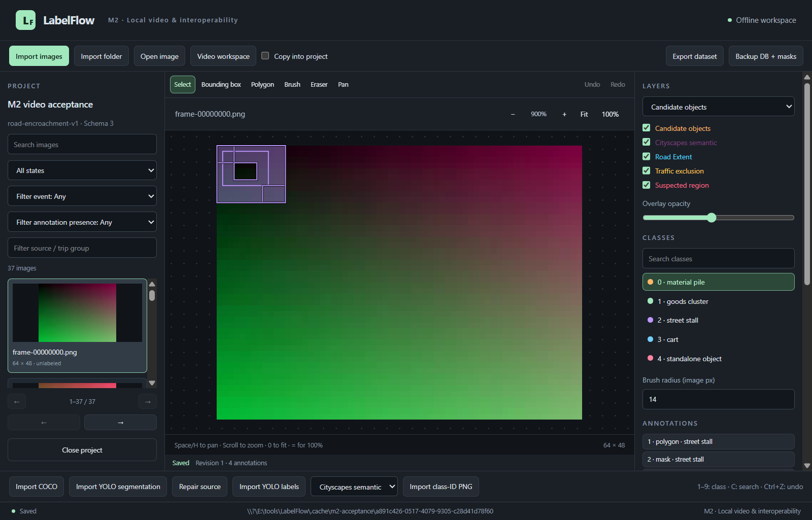
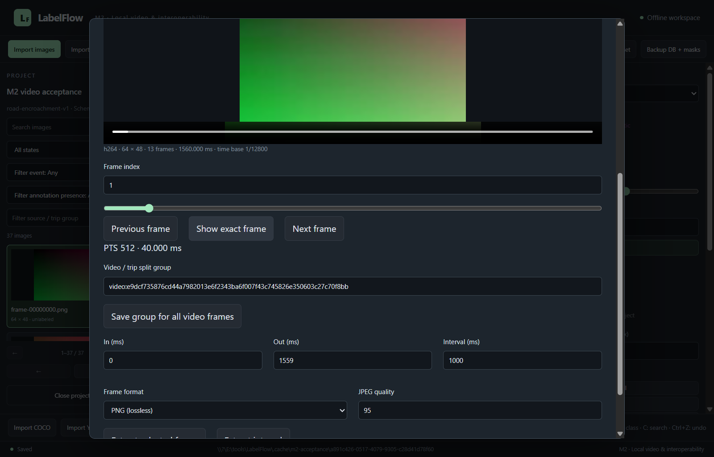
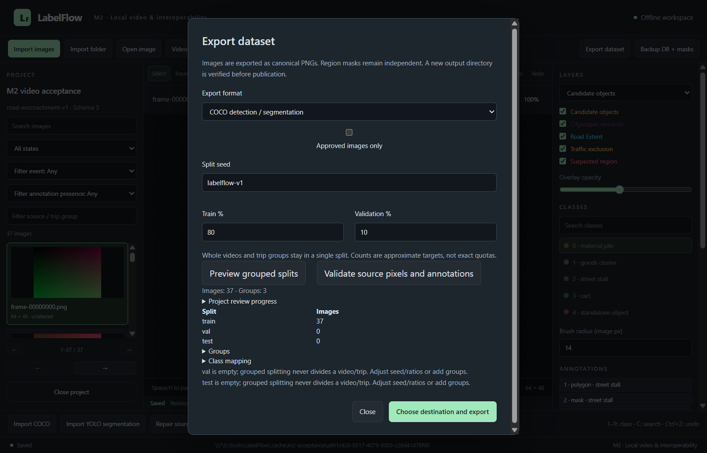

# M2 — Video workflow and dataset interoperability

Hoàn thành phạm vi kỹ thuật M2 trên Windows x64; dừng trước M3. Không có cloud, server, tài khoản, telemetry, model hoặc AI worker. Hướng dẫn chạy và thao tác nằm trong [README](../../README.md); quyết định kiến trúc trong [ADR 0003](../decisions/0003-video-interoperability.md).

## Chức năng đã triển khai

- Video local: chọn FFmpeg/FFprobe, FFprobe metadata/PTS index, playback bằng WebView, timeline, seek theo thời gian, stepping, preview chính xác, trích frame thủ công hoặc theo interval, PNG/JPEG/quality, progress và cancel. Xác minh SHA-256; không thay đổi video nguồn. Frame lưu nguồn video, integer PTS, time base, index, thời gian và cấu hình trích.
- Chống trùng: cùng video/frame giữ nguyên media ID và annotation; hủy job giữ frame đã commit. Một video sở hữu group của toàn bộ frame; có thể gộp nhiều video cùng trip group. Sửa group riêng của frame không thể làm rò rỉ split.
- COCO detection/instance import/export: bbox, polygon, nhiều thành phần rời, uncompressed/compressed RLE, crowd RLE và holes qua mask. Instance mask tách khỏi semantic/region, lưu PNG immutable ngoài DB. Canvas hiển thị/hit-test, đổi class/xóa có xác nhận; multiple polygons có thể di chuyển cùng nhau.
- YOLO segmentation import/export: mapping class tường minh, normalized polygon, giữ tọa độ subpixel; từ chối bbox/holes/disconnected components/RLE mặc định. Override bỏ qua phải do người dùng chọn, report ghi rõ annotation. Không tự xấp xỉ mất dữ liệu.
- Nhập nhãn cùng nội dung có ID ổn định, không tạo thêm instance; ảnh approved được bảo vệ. Semantic PNG/train-ID/ignore tiếp tục là luồng riêng của M1.
- Review: approved/rejected, event/notes, lọc event/group/annotation presence cùng phân trang/search/review. Wizard có preview counts/group/class map, tổng hợp trạng thái review, QA sâu và grouped train/val/test split. Cảnh báo split trống rõ ràng.
- Sửa đường dẫn ảnh và video bằng đúng SHA-256 gốc; ảnh còn kiểm tra kích thước/orientation. Cache preview có checksum, rebuild khi hỏng, quota, preload ảnh/frame lân cận và opaque resource URL; không truyền lại toàn ảnh bằng base64 khi chuyển ảnh.
- Khóa shortcut và giữ focus trong modal; thao tác có pending save vẫn được flush/guard như M1. Không đổi hay bỏ journal/revision/conflict protection.

## Module và migration

Module mới: `src/features/video/VideoWorkspace.tsx`, `src/app/m2Strings.ts`, `src/components/useModalFocus.ts`; Rust `video/{mod,process,tools}`, `domain/{video,geometry}`, `import/instances`, `export/instances`, `services/{quality,preview}`, `security/resources`, `commands/m2`.

Các module hiện có được mở rộng có chủ đích: typed IPC/capabilities; renderer/hit tests/history cho mask/multiPolygon; library filters; export wizard; annotation assets/validation; project schema. Không thêm npm/Cargo runtime dependency. Test/fixture mới ở `src-tauri/tests/video_interoperability.rs`, `geometry/instances.test.ts`, `tests/ui/workspace.spec.ts`, `tests/fixtures/video` và `scripts/*m2*`.

[Schema 3](../formats/project-v3.md) backup DB schema cũ trước migration. Bảng media được rebuild để FK nguồn trỏ đúng `videos(id)`; annotation giữ nguyên IDs, state, operation log và mask assets. Kiểm thử schema 2→3 xác minh polygon và pixel mask không đổi, FK không lỗi, backup vẫn là schema 2. Bản ứng dụng schema 2 sẽ từ chối schema 3; không có downgrade tự động.

## Nghiệm thu đã chạy

| Kiểm tra                                                                 | Kết quả                                                                                      |
| ------------------------------------------------------------------------ | -------------------------------------------------------------------------------------------- |
| TypeScript, ESLint, Prettier, Rust fmt, Clippy `-D warnings`, Vite build | Qua                                                                                          |
| Vitest                                                                   | 208 test qua                                                                                 |
| Launcher/Windows PATH regression                                         | 6 test qua, gồm shell con tìm được npm                                                       |
| Rust mặc định                                                            | 40 test qua; 5 test helper/acceptance được ignore có chủ đích                                |
| Playwright browser                                                       | 16 luồng qua, gồm M1 và M2; IPC mock chỉ trong browser test                                  |
| FFmpeg acceptance riêng                                                  | Qua với CFR, VFR/B-frame và rotation 90° thực; kiểm tra cả JPEG                              |
| Đối chiếu độc lập video                                                  | 37 frame PNG khớp từng pixel với full-stream decode; PTS khớp FFprobe                        |
| COCO API                                                                 | 148 annotation đọc được; 74 RLE khớp pixel và area                                           |
| Parser YOLO chính thức                                                   | 37 cặp ảnh/segmentation được chấp nhận                                                       |
| Tauri packaged + Rust/SQLite thật                                        | Playback H.264, VFR exact preview, trích lại frame, binary preview protocol và QA wizard qua |
| Tắt/mở tiến trình thật                                                   | 37/37 tài liệu và mask khớp hoàn toàn                                                        |
| Nhập tăng dần 10.000 PNG                                                 | Hủy sau 100, nhập tiếp 9.900, nhập lại nhận đủ 10.000 trùng; nhãn cũ giữ nguyên              |

Các test ignore mặc định gồm helper tiến trình lock/crash (được test cha gọi), nghiệm thu 100 ảnh thật của M1 (đã chạy ở M1), video M2 và 10k M2. Hai acceptance M2 được chạy riêng. Không gọi test bị ignore là đã chạy chỉ vì `cargo test` báo xanh.

Parser độc lập: COCO API `pycocotools 2.0.11`; các hàm verify ảnh/nhãn Ultralytics và NumPy helpers nguyên bản từ commit `3cd02542899c1bcab5690b02033bc18aa07df0d4`, kiểm tra SHA trước chạy AST. Không cài Torch, chạy training hoặc suy luận mô hình. Đây là nghiệm thu parser/loader, không khẳng định đã huấn luyện hoàn chỉnh.

Dữ liệu M2 là fixture sinh tự động, không phải ground truth đường phố do người gán. 100 ảnh LostAndFound thật và kiểm tra restore chính xác thuộc nghiệm thu M1; xem [báo cáo M1](M1.md). Nguồn ảnh/video được giữ nguyên.

Artifact kiểm thử: `.cache/m2-acceptance/{latest,parsers,desktop}.json`, `.cache/m2-large/latest.json`. Lệnh tái lập trong README; [benchmark M2](../benchmarks/M2-windows.md) ghi phạm vi đo và giới hạn.

## Ảnh giao diện native

## Giới hạn còn lại

- M2 index tối đa 100.000 frame/video, 10.000 frame/job, nguồn tối đa 64 GiB và FFprobe JSON tối đa 64 MiB. Frame decode tối đa 10 phút. Frame ở xa vẫn giải mã từ đầu clip nên có thể chậm; chưa dùng keyframe seek tối ưu.
- Playback phụ thuộc codec WebView; FFmpeg exact preview là fallback. Đã kiểm thử FFmpeg 9.0.2 trên máy này; công cụ quá cũ có thể không hỗ trợ option. Không đóng gói FFmpeg; người dùng chọn công cụ local.
- Instance masks/holes dạng RLE được bảo toàn, nhưng chưa có brush/contour editing cho instance. COCO crowd vector không có RLE bị từ chối để tránh mất crowd semantics. Mapping export theo profile ổn định, chưa có editor class tùy ý.
- Nhập nhãn yêu cầu ảnh đã được nhập, basename duy nhất hoặc media UUID. M2 chưa có bulk remap cả thư mục nguồn; repair thực hiện từng ảnh/video có exact hash. Backup gồm DB/mask, nguồn cần backup riêng.
- Tỷ lệ split là mục tiêu theo nhóm; ít video/trip có thể làm val/test trống. Wizard/report cảnh báo, không chia nhỏ video để đạt tỷ lệ.
- Chưa nghiệm thu video đường phố Việt Nam hoặc Ubuntu/installer; chưa chạy full training pipeline. Chưa khẳng định các mục tiêu startup, 60 FPS, <150 ms navigation hay tổng RAM WebView <400 MB đã đạt.
- Staging export thất bại và asset orphan được giữ để chẩn đoán; không có tự động xóa dữ liệu authoritative. Các giới hạn hiệu năng và phân phối được ghi ở ADR/benchmark.

## Việc tiếp theo ở M3 — chưa triển khai

1. Thiết kế Python worker optional, handshake/IPC JSON-lines có version/request ID qua stdio.
2. Quản lý start/stop/cancel/restart và lỗi worker; manual workflow hoạt động khi không có Python/model.
3. Adapter ONNX CPU đầu tiên và kiểm tra schema/class map/kích thước trước nhận output; PIDNet chỉ sau khi đối chiếu output thực tế.
4. Lưu prediction dưới dạng suggestion có provenance; overlay/approve/reject, tuyệt đối không ghi đè nhãn approved.
5. Test worker hỏng, hủy, sai kích thước/class, và chứng minh không làm hỏng project/mask/manual edits.

Dừng ở đây để người dùng kiểm tra M2 trước khi cho phép M3.
