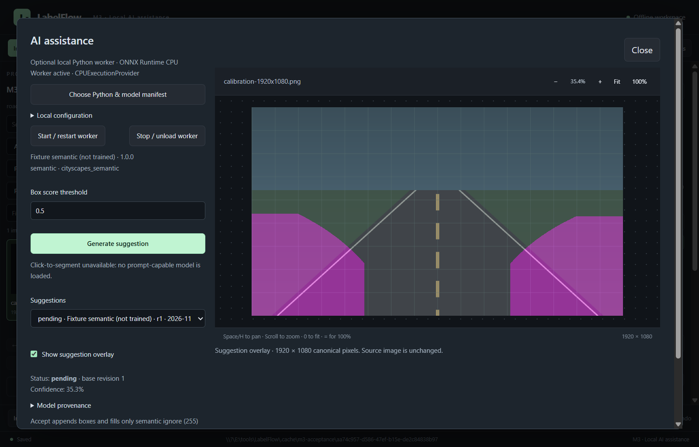
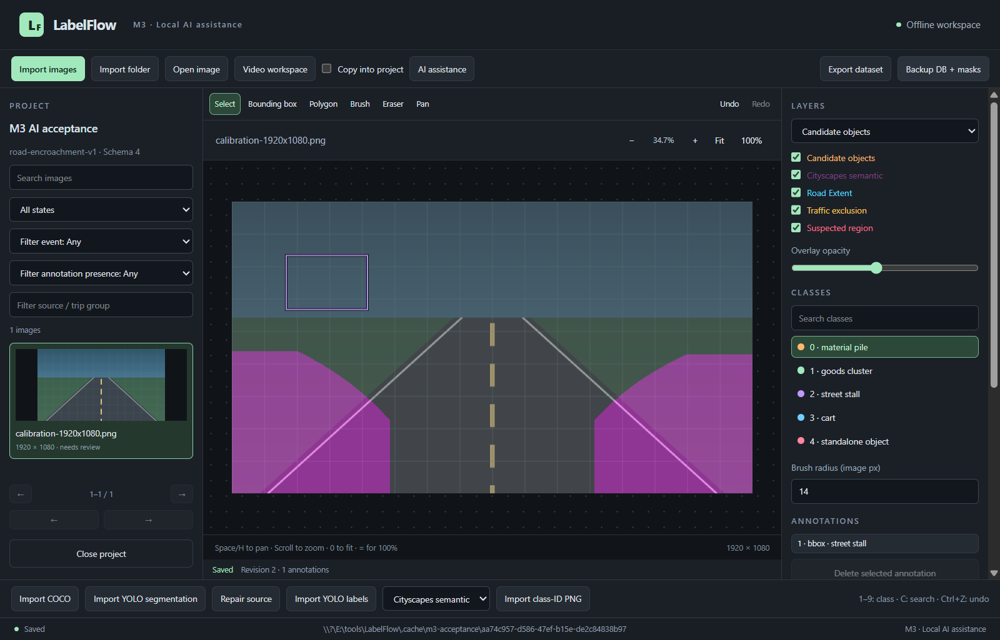

# M3 — Optional local AI assistance

Phạm vi theo master plan: Python worker tùy chọn, versioned stdio IPC, CPU ONNX adapter, suggestion overlay/approve/reject và bảo vệ nhãn thủ công. Không triển khai M4, cloud, inference server, training hoặc tự tải model.

## Đã triển khai

- Worker Python local với protocol version/request ID; handshake có capabilities, model, provider/device, input geometry và output format. Có health/catalog/load/predict/cancel/unload, deadline, bounded IPC, phát hiện crash, kill/wait, cleanup và restart tường minh. Hủy ORT call bằng kết thúc tiến trình; không nhận kết quả muộn vào DB. Đóng project dừng worker; đóng pipe ứng dụng cha kết thúc worker.
- Chọn interpreter/model manifest bằng native dialog, lưu settings ngoài project. Worker source nhúng trong executable; Python/runtime/weights do người dùng cung cấp. Gán nhãn ảnh/video/import/export không cần môi trường AI.
- ONNX CPU semantic logits/label map và detection sau NMS với schema tường minh. SHA-256 và input/output được kiểm tra, chạy dry-run graph thật trước khi nạp. Semantic resize logits trước argmax; class map dùng stable IDs. PIDNet contract giới hạn exact 19 Cityscapes channels và semantic head được khai báo; output sai số kênh bị từ chối. Không có prompt model nên click-to-segment hiển thị lý do chưa hỗ trợ.
- Schema 4 lưu dự đoán/provenance/confidence/metadata ở `ai_suggestions` riêng. Overlay bật/tắt và zoom/pan riêng; pending/rejected không vào export. Chấp nhận thêm bbox hoặc điền semantic ignore; không sửa pixel đã gán hay object cũ. Ảnh approved và revision đã thay đổi được bảo vệ. Review sau accept là `needs_review`.
- Accept commit tài liệu, operation log và trạng thái/audit suggestion trong cùng transaction. Undo/editor journal vẫn dùng luồng M1; lịch sử chấp nhận được giữ như audit, kể cả khi undo. Backup/restore bao gồm suggestion qua SQLite, không cần model để xem lại dự đoán đã lưu.

Module: `src/features/ai`, `src-tauri/src/ai`, `commands/m3.rs`, `worker/`; [ADR](../decisions/0004-local-ai-worker.md), [schema/migration](../formats/project-v4.md), [hướng dẫn và IPC contract](../../worker/README.md).

## Nghiệm thu

Môi trường Windows x64, Python 3.12, ONNX Runtime 1.31.1 **CPUExecutionProvider**, NumPy 2.5.4, Pillow 13.0.0. Model kiểm thử là graph Conv/Constant nhỏ tự tạo bởi dự án; không phải model đã huấn luyện. Người dùng xác nhận hiện chưa có model ONNX thực tế.

| Kiểm tra                                                                 | Kết quả                                                                                                                                               |
| ------------------------------------------------------------------------ | ----------------------------------------------------------------------------------------------------------------------------------------------------- |
| TypeScript, ESLint, Prettier, Rust fmt, Clippy `-D warnings`, Vite build | Qua                                                                                                                                                   |
| Vitest                                                                   | 208 test qua                                                                                                                                          |
| Launcher / Windows PATH                                                  | 6 test qua                                                                                                                                            |
| Rust mặc định                                                            | 49 test qua; 7 helper/acceptance ignore có chủ đích                                                                                                   |
| Browser UI                                                               | 18 luồng qua, gồm M1/M2 và AI optional, overlay, accept/undo/reject, cancel                                                                           |
| Python worker                                                            | 9 test qua với inference CPU thật; exact pixel, logits resize trước argmax, threshold/coordinates, wrong schema, EOF và unload                        |
| Rust supervisor riêng có Python                                          | Qua: CPU inference, crash, malformed JSON, output quá lớn, timeout, cancel, restart; tài liệu approved giữ nguyên                                     |
| Native Tauri + Rust/SQLite                                               | Qua: thiếu Python vẫn đọc/sửa nhãn, inference 1920×1080, overlay, accept/reject, stale revision, sai PIDNet schema, original SHA và mở lại tiến trình |
| Pixel semantic khi accept                                                | Toàn bộ 2.073.600 pixel khớp suggestion đã map, ngoại trừ pixel thủ công cố ý được giữ nguyên; bbox thủ công giữ nguyên                               |
| Migration / backup / atomicity / export                                  | Schema 3→4 có backup và giữ nguyên doc; backup/restore giữ provenance; lỗi cập nhật review rollback doc/operation; COCO không chứa pending/rejected   |

Các test ignore cũ gồm helper lock/crash do test cha gọi và acceptance M1/M2 đã nghiệm thu ở milestone trước. M3 chạy riêng supervisor thật và helper tạo project native. Không chạy lại phép đo 10.000 ảnh hay parser/training M2 vì M3 không thay các pipeline đó. Native file picker chọn interpreter/manifest chưa được tự động hóa; smoke ghi cấu hình vào thư mục test riêng rồi gọi đúng command production. CI đã bổ sung job step optional AI cho Windows/Ubuntu; kết quả trên Ubuntu chưa được chạy trên máy hiện tại.

Lỗi phát hiện và đã sửa: race/lock khi thread đọc stdin chặn NumPy DLL init trên Windows (đổi sang watcher pipe không blocking); phím zoom/fit/pan của canvas trong modal được giới hạn đúng modal đang hoạt động; lỗi type/lint/format phát hiện bởi checks đã được sửa. Native WebView2 smoke chạy ngoài sandbox để tạo CDP; executable production không bật CDP hoặc inference listener.

Tái lập: `npm.cmd run check`, `npm.cmd run test:ui`, `npm.cmd run test:ai`, `npm.cmd run test:m3:desktop`, `npm.cmd run desktop:build`. Không chạy Cargo ghi lại executable đang mở. Artifact: `.cache/m3-acceptance/{latest,desktop}.json`; báo cáo này và ảnh dưới đây được lưu trong `docs`.

## Giới hạn còn lại

- Chưa có trained ONNX/PIDNet từ người dùng: đã kiểm tra schema và cơ chế thật, **chưa đánh giá độ chính xác hoặc chất lượng gán nhãn**. Cần đối chiếu normalization, class map, output head và interpolation của model thực trước khi dùng cho dataset. PIDNet yêu cầu align-corners hoặc schema khác cần adapter/test tương ứng.
- CPU-only, một ảnh/request; chưa có batch queue, GPU/provider, raw YOLO decode/NMS, letterbox/BGR, external ONNX tensors hoặc prompt mask. Trần manifest/model/input/output/IPC/deadline nêu trong worker README; model vượt budget bị từ chối. Không khẳng định mục tiêu RAM/throughput toàn ứng dụng đã đạt.
- Accept semantic chỉ điền ignore, không có chế độ thay thế nhãn cũ. Model confidence không phải độ chắc chắn đã hiệu chuẩn; label-map output không có confidence. Suggestion history UI hiển thị 100 bản ghi, ưu tiên pending, tối đa 10 pending/ảnh; audit cũ vẫn ở DB và không tự xóa.
- Windows native đã nghiệm thu; Ubuntu, installer và thao tác native file picker cần nghiệm thu riêng. Python environment cài thủ công, ngoài executable; model/interpreter cần lấy từ nguồn người dùng tin cậy. Không bundle weights hoặc thực hiện download khi app chạy.

## M4 — chưa triển khai

1. Hoàn thiện workflow Road Extent, traffic exclusion, suspected region và event review chuyên biệt, không trộn candidate object với ground-truth event.
2. Review model so với ground truth, hiển thị disagreement và chuyển nhanh giữa overlay; giữ invariant không ghi đè nhãn đã duyệt.
3. Hard-negative tags, tổ chức trip/session và metadata phục vụ rà soát/chia tập.
4. Metric hỗ trợ đánh giá theo đúng loại nhãn và báo cáo chất lượng; nghiệm thu bằng model thực và dữ liệu đường phố được phép dùng.

M3 kết thúc tại đây; chờ người dùng kiểm tra trước khi triển khai M4.
